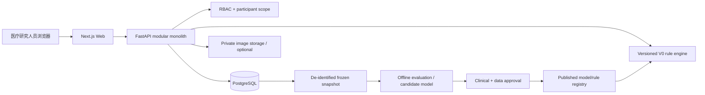

# Architecture overview

Start here for system-level design; detailed decisions live in `docs/architecture/`.

**Nonnegotiable:** clinician approval precedes effective recommendations; offline ML cannot mutate live clinical logic directly. See [system design](docs/architecture/SYSTEM_DESIGN.md), [security](docs/security/SECURITY.md) and [ADR index](docs/decisions/README.md).
