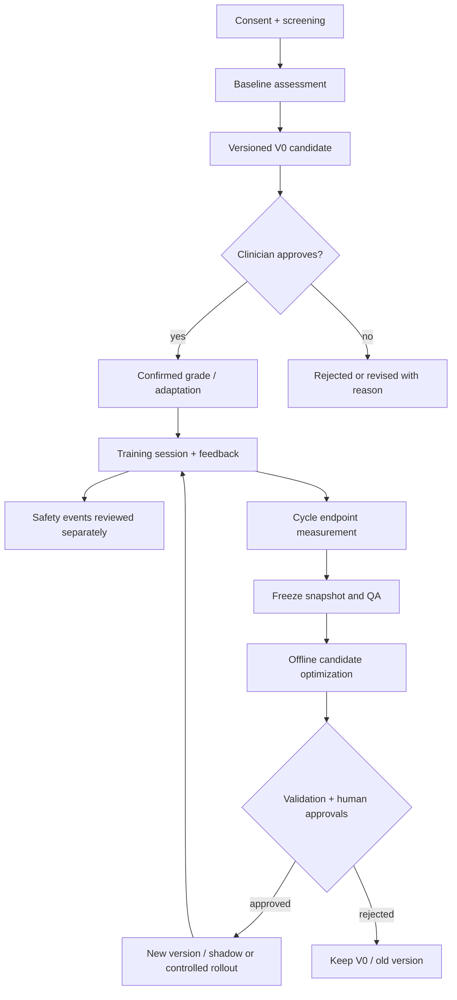

# Data flow, trust boundaries and state machine

**Trust boundaries**
1. Browser inputs untrusted; backend authorizes and validates all objects.
2. Identity mapping available to limited staff only; general research exports use coded IDs.
3. Images are sensitive; never automatically persist to public object storage.
4. Offline research workloads receive only purpose/consent-eligible frozen snapshots.
5. External LLM has no direct access to patient records; literature inputs must be vetted and source-cited.

**State examples**: assessment `draft → submitted → confirmed → amended`; recommendation `proposed → approved/rejected → published/superseded`; session `planned → in_progress → completed/aborted`; optimization `candidate → evaluated → pending_review → approved/rejected → shadow/released → retired`. Enforcement lives on server.
