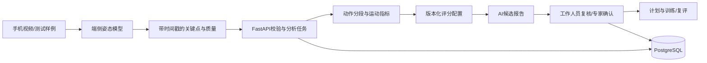

# AI 太极视频辅助评估方案

日期：2026-11-26。任务：`DEMO-V2-09`。状态：首版产品与工程方案；识别、评分和摄像功能尚未实现。

同日接续实施说明：上述状态为方案09检查点。任务10/11已接入真实姿态模型、合成视频/测试摄像入口、关节指标、数据库与人工观察复核；详见[验证目标与限制](../testing/AI_POSE_VALIDATION.md)和[ADR-0016](../decisions/0016-local-pose-geometry-evidence.md)。本文其余章节为目标设计，不代表评分/阶段/计划全部交付。

## 1. 建议做成什么

把 AI 视频评估作为下一阶段的主要展示能力：**工作人员建立评估任务 → 手机拍摄太极动作 → AI 提取人体关键点并连线 → 打完后生成有依据的初评报告 → 工作人员复核评分 → 专家确认阶段与康复建议 → 接入现有训练和复评闭环。**

手机是工作人员控制的采集终端，先沿用研究人员工作台，不另做患者 App。录制时显示取景和识别状态；主要评分在结束后完成，第一版不做实时治疗指导。页面以任务、结果和证据为主，集中展示一次“AI初评／待审核”状态说明，避免反复弹窗影响演示。

这里将“根据关节点进行线性人评估”暂理解为**人体骨架连线与运动几何分析**，不是先假定采用线性回归。若以后建立预测量表分数的回归模型，需要另有配对标签和验证结果。

核心价值应当可以现场验证：骨架随动作变化；报告能定位对应时间片；工作人员能修改并保留 AI 原值；刷新后能看到同一份评估与审核历史。

## 2. 整体项目核查结论

已核查文档索引、PRD、范围与验收、路线图、任务/状态/交接、架构、数据模型与量表字典、研究接口、特征/规则说明、相关 ADR，以及下列实际代码。开始时工作区干净，分支 `feat/real-01f0-coded-export`，HEAD `80993bf418065fb9dd472c0a8ba9fa5ac2cb2963`。

| 现有能力 | 代码事实 | 本次如何复用 |
|---|---|---|
| 登录与对象权限 | FastAPI 会话、研究/对象范围、审计 | 每项评估沿用现有参与者和授权 |
| 人工量表 | `backend/app/assessment.py`、`assessment_api.py` 支持人工 SPPB 总分及追加修订 | 作为已有功能基线与工作人员复核入口 |
| Demo 分级与训练 | `demo_rule.py`、`demo_api.py`，已有等级、12 条动作、训练和反馈 | 审核后关联计划与训练记录 |
| 姿态页面 | `frontend/app/participants/[id]/pose-demo/` 仅切换 SVG，无视频、模型或评分 | 保留历史演示，新建独立 AI 评估入口 |
| 离线 ML | `ml/offline_dataset.py` 为合成数据质量检查和对象级切分 | 后续建设人工标签与验证集 |

仓库提到 SPPB、FRAIL、步速、坐站、TUG、握力，但当前自动化基础不是完整多量表系统；已实现的是人工 SPPB 总分。未找到原始量表附件或太极逐项评分表，因此不能声称已经掌握“之前量表”的全部项目、权重和操作细则。

本次用户方向将原 P1/P2 的视频 AI 提升为下一阶段重点。旧 PRD 的“仅姿态壳”和 ADR-0008 描述的是现有实现；本方案设计新增能力，不把旧页面改写成已经具备识别功能。

## 3. 两类评估，汇入同一报告

### A. 太极动作 AI 初评：优先实现

用户选择动作/训练片段类型，再拍摄。第一版选择少量、固定流程的动作模板，具体动作与标准演示由专家指定；不承诺直接识别任意流派、整套拳或所有视角。

输出候选维度：上肢活动幅度、下肢屈伸幅度、躯干倾斜变化、左右动作表现、节律连续性、可观察的动作完成情况。每项附原始指标、有效覆盖、时间片和“可评估／不可评估”的原因。模板没有规定左右对称时，不把左右不同直接判成错误。

这是太极任务下的动作表现评估，不直接命名为 SPPB 分数。若需要综合展示分，应使用独立名称和版本，例如“太极动作表现演示分”；评分权重、归一化范围、总分制式由评分表确定，第一版不自行编造临床含义。

### B. 既有量表 AI 辅助测量：后续接入

SPPB 包含平衡、步行与坐站任务，需按对应测量流程采集，不能只拍一段太极就补齐全部项目。参见 [APTA 的 SPPB 说明](https://www.apta.org/patient-care/evidence-based-practice-resources/test-measures/sppb)。

| 项目 | AI 可先提供的辅助信息 | 还需要什么 |
|---|---|---|
| 平衡任务 | 姿态片段、可见保持时段、关键点轨迹 | 测试姿势、开始/终止判定及人工核对 |
| 步行任务 | 可见步行片段、候选计时点 | 实际距离、取景标定、量表 SOP；无标定不报 m/s |
| 坐站任务 | 候选重复次数、起止时刻、动作分段 | 指定测试流程、扶手/协助等工作人员记录 |
| FRAIL | 展示问卷与人工答案 | 不能从视频补答问卷 |
| 握力 | 关联人工/设备测量 | 摄像头不输出握力数值 |

先让 AI 辅助“测到了什么”，再按专家确认的量表版本计分。未测项目保持未知，不用模型补成正常或零分。

## 4. 页面与演示流程

1. **对象详情：新增“AI视频评估”。** 选择太极动作评估或量表任务，显示既有人工评估日期及版本，避免混用不同时间的基线。
2. **采集页。** 工作人员选择任务、拍摄方向、辅助方式；手机固定取景，提示全身入框、单人、遮挡情况。提供模型加载、摄像拒绝、设备不支持和重新录制状态。用合适来源的样例可重复演示同一任务。
3. **录制与识别。** 视频上叠加关节点与骨架连线；提示“已识别／部分遮挡／暂未识别”。录制中可停止；停止不自动当作完成任务。
4. **分析页。** 显示真实处理进度及失败原因；预检、关键点分析和报告生成分开。低质量片段可重录，也可交人工评估。
5. **AI报告页。** 左侧骨架回放与时间轴，右侧分项指标/候选分、依据和不可评估项；底部显示阶段候选及建议草案。点击问题项跳到对应片段。
6. **工作人员审核页。** AI值、工作人员值、专家最终值分别展示；逐项接受/修改/拒绝，保存原因和版本。研究助理可整理，最终确认复用现有临床角色并细化权限。
7. **训练与复评。** 审核后的结论关联已有动作库/训练；下次以相同任务和版本对照。更换模型或评分表时另建结果，不覆盖旧报告。

演示叙事为“AI发现可观察表现 → 人能回看证据 → 人调整建议 → 训练后再评估”。“AI已经分析完”和“最终结论已确认”是两个不同状态。

## 5. 技术路线：预训练姿态模型 + 可解释分析

首选验证 **MediaPipe Pose Landmarker** 的浏览器方案。官方支持图像/视频人体关键点检测，输出 33 个关键点及坐标；Web 示例可处理摄像流并绘制骨架。模型、WASM 和 SDK 固定版本、校验哈希并随部署提供，不把官方示例里的 `latest` 或公共 CDN 当作交付配置。来源：[官方 Web 文档](https://developers.google.com/edge/mediapipe/solutions/vision/pose_landmarker?tab=Web)。

以上说明它能提供姿态输入，不代表已经证明适合本项目评分。先做样例推理和目标手机测试，再决定模型档位、Worker/主线程调度及 CPU/GPU 回退。第一版不从零训练姿态网络，也不依赖 GPT 看视频给分。

算法初版依次处理：

- 读取原始采集时间戳，检查缺帧、关键点可见性、多人与画面完整性。质量门限是待设备实验确定的工程参数，不是医学阈值。
- 明确图像坐标与模型估计三维坐标的区别；保存镜像/方向信息。二维几何先恢复画面宽高比例，避免把归一化横纵坐标直接当相同尺度。
- 按有效帧平滑与分段；长缺口不插值成完成动作。所有时长按时间戳计算，避免按固定帧率误算。
- 用肩—肘—腕、髋—膝—踝等向量求夹角：`acos(clip(dot(u,v)/(norm(u)*norm(v)), -1, 1))`。零长度向量或不可见关键点返回缺失。
- 提取角度范围、轨迹、节律与左右片段差异；躯干中点轨迹只叫“位移代理指标”，不能直接称为真实重心或受力测量。
- 有指定任务和标准模板后，再考虑时间对齐/参考轨迹差异。健康示范与个体存在幅度差异，模板相似度本身不等于康复水平。
- 将指标映射到版本化评分条目。没有配置的条目只报指标和待评，不产生假分数；不能把骨架模型置信度当成临床判断的可信概率。

端侧模型是真正的 AI 识别；后续几何/规则分析负责解释结果。以后有专家配对标注后，可训练阶段/评分模型；模型候选必须与原始可解释基线比较。

## 6. “目前什么阶段、该怎么康复”如何呈现

报告明确区分三个结果：

| 输出 | 信息依据 | 第一版显示 |
|---|---|---|
| 本次太极动作表现 | 当前视频有效片段及任务评分表 | 分项指标、候选评分、待审核 |
| 功能分级 | 已确认量表及分级规则版本 | 可引用现有 Demo I–IV，但注明量表来源/日期；缺失则未评估 |
| 康复阶段与计划建议 | 专家定义的阶段规则、量表、动作表现、人工症状/协助记录 | 专家未提供映射时显示待评；有模板后生成待审核草案 |

AI 不把“动作完成得像不像”直接改名为“疾病处于哪个阶段”。用户提出的“康复阶段”需要专家具体定义；它可能与现有 I–IV 功能等级不同。第一版把字段和审核链路做出来，不自行创造新的疾病分期。

建议卡可以显示关注维度、拟关联动作、依据、待补信息及审核状态。实际动作适配、训练剂量和进退阶条件来自专家版本化模板；本方案不预填治疗强度或疗程。Demo 可关联现有 `DEMO_ONLY` 动作展示，但不能称为正式治疗处方。后续自然语言说明优先用模板；如引入 LLM，只解释已有结构化结果，另行定义接口及数据范围。

## 7. 与现有后端和数据库衔接（拟议，未建表/路由）

不改写人工 `assessment_revisions.source = manual_staff_entry` 的现有含义。AI 结果先进入独立记录；将来接入量表确认时新增带来源引用的结构化测量路径，不伪装成人工输入。

| 拟议实体 | 关键内容 |
|---|---|
| `video_assessment_tasks` | 对象、任务/SOP版本、采集来源、操作者、采集时间、输入哈希、状态 |
| `pose_analysis_runs` | 模型/哈希、分析配置/代码版本、数据截止时间、质量、输入快照引用、错误原因 |
| `pose_metric_results` | 分项指标、单位、有效性、缺失原因、证据时间片；关键点序列使用受控存储引用 |
| `ai_assessment_candidates` | AI原始候选、评分/阶段配置版本、模型依据、量表修订引用、`MODEL_CANDIDATE` 与 `DEMO_ONLY` 用途 |
| `ai_review_revisions` | 原候选ID、审核值/决定/原因、操作者/时间、前一版本；人工确认使用独立 `HUMAN_CONFIRMATION` |

`DEMO_RULE` 仅用于确定性的演示映射；`MODEL_CANDIDATE` 表示模型候选；`HUMAN_CONFIRMATION` 表示人工决定；`CLINICAL_RULE` 留给获确认的规则发布体系。记录类型和 Demo 用途不能混成一个“已批准”布尔值。

拟议 API：`POST /participants/{id}/video-assessments` 创建任务；`POST /video-assessments/{id}/landmarks` 提交版本化关键点；`POST /video-assessments/{id}/analyses` 创建分析；`GET /video-assessments/{id}` 读状态/报告；`POST /video-assessments/{id}/reviews` 追加审核。名称待任务10补齐正式 API/数据契约。

输入校验涵盖时戳单调性、关键点数量/模型版本、有限数值、负载大小、对象范围与任务归属。评分由后端计算；客户端上报的关键点属于输入证据，不能因通过 schema 就称为经过临床验证。重复请求幂等；并发审核校验预期版本，过期请求拒绝并要求刷新。重跑创建新分析记录，旧候选仍可回看。

任务状态建议为 `created → collecting → queued → analyzing → ready`，分支含 `failed/cancelled`；审核另设 `pending/accepted/modified/rejected`。任务 ready 不等于审核通过。

## 8. 影像处理与工程推进

功能开发继续用合成关键点、合成视频和有来源/授权记录的专用测试样例。真实患者采集、上传、影像留存是单独的数据接入事项，不让它阻塞关键点分析、后端持久化或审核界面的开发。

首选原视频在采集端处理，服务端先接关键点和指标；关键点同样按对象数据保护，不能称为天然匿名。原视频是否上传、如何供专家跨设备回看、保存多久，需要决定后实现；本方案不设默认留存期限。仅本次浏览器会话的视频回放与持久化报告要明确区分：重新打开可能只能看骨架证据，不能假装原视频还在。

本机电脑的 localhost 摄像可用不代表手机访问局域网 HTTP 就能使用摄像头；手机采集验收需要可用的安全上下文、权限及实际设备测试。无权限、模型加载失败或算法未运行时，必须显示具体状态，不返回固定“AI评分”。

## 9. 开发拆分与最小验收

| Task ID | 最小交付 | 验收 |
|---|---|---|
| DEMO-V2-09 | 本方案、ADR及台账 | AT-AI-DOC-01：现状/提案分开、量表映射与开发顺序明确、链接检查 |
| DEMO-V2-10 | 合成关键点→FastAPI→指标→PostgreSQL报告；模型适配协议 | AT-AI-01：可复算角度/时长，未知非零，重跑版本/幂等/权限/刷新；增量迁移测试 |
| DEMO-V2-11 | 固定版本姿态模型接入、合成视频样例、手机采集界面 | AT-AI-02：真实模型推理而非预置输出；骨架与时间戳对应，失败/遮挡可见；设备测试 |
| DEMO-V2-12 | 指定动作分段、版本化评分表与候选报告 | AT-AI-03：分数能追到指标/配置/片段；无配置和低质量项不可评估；评分表依赖专家输入 |
| DEMO-V2-13 | 工作人员逐项复核、专家确认、计划关联 | AT-AI-04：原AI值不覆盖，越权/并发拒绝，确认与拒绝均有历史；计划映射依赖模板 |
| DEMO-V2-14 | 完整数据库/浏览器/手机演示与专家标注验证 | AT-AI-05：采集→报告→审核→训练→复评可重开；失败分支、缺失和旧业务回归 |

预计代码范围：新增 `frontend/app/participants/[id]/ai-assessment/` 和 typed client；新增 `backend/app/pose_*`、模型及增量迁移；`ml/` 放离线标注/验证工具；沿用现有认证与训练 API。先完成任务10并记录检查点，再进入摄像/模型集成，不一次改完整个平台。

验证不仅看“能画出人”：以可计算的合成序列核对角度和时间，以模型真实推理样例检查识别链路；以专家独立标注检查动作分段/评分一致性。报告误差、失败率、有效覆盖率和审核修改情况；训练/测试按参与者隔离，同一人片段不跨组。没有执行实验前不写准确率、临床有效性或模型优于人工。

## 10. 专家输入清单与下一步

需要的最少材料：既有量表原表/SOP与版本；首批动作及标准演示；每个评分维度的锚点/权重/不可评估规则；“康复阶段”的确切定义和映射；动作/计划模板及审核角色。它们集中记录在 [待决问题 Q-14/Q-15](../OPEN_QUESTIONS.md)，不要求等待全部材料后才开始基础工程。

下一步推荐 `DEMO-V2-10`：先把可复算、可保存、可复核的关键点分析做实，再接入真实姿态模型与手机采集。届时最小展示不只是骨架动画，而是一个能产生实际分析记录、接受人工修订、接入原训练闭环的 AI 评估模块。
