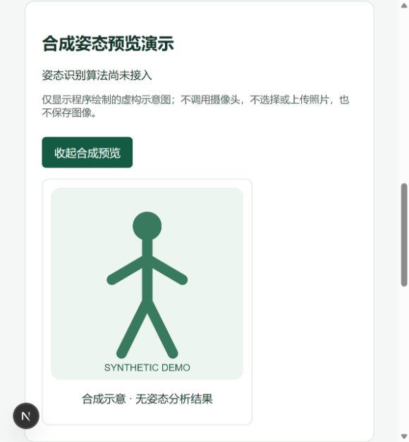

# S6-01 纯合成姿态预览：本地验收记录

> **适用版本限制**：后续远端复核发现 `origin/main` 已包含另一套 S6-01 实现。本报告及截图仅适用于下述旧基点上的本地展开式预览；不验证远端独立 `/pose-demo` 页面，不作为覆盖远端台账或新增功能的依据。详见[差异记录](S6-01-REMOTE-RECONCILIATION.md)。

- 日期：2026-10-31，Asia/Shanghai。
- 构建基点：`main` / `a69aac8673289101ffa761008060fe35c62e0001`，附 S6-01 的原有 12 个未提交文件；不是该 SHA 已包含本功能。
- 执行者：Codex（浏览器操作及截图目视检查）。代码/产品审查与负责人最终签核待完成；没有临床签核声明。
- 范围：[ACCEPTANCE AT-12](../product/ACCEPTANCE.md) 的 S6-01 纯合成回退路径、[UAT](UAT.md) 第 8 步及第 9 步相关对象 URL 授权。未验收导出、备份恢复或整套临床 UAT。
- 结论：纯合成范围本地验证完成；S6-01 台账 `DONE` 仅指该范围，提交、PR、远端 CI 仍待后续授权与审查。

## 独立工具链与质量检查

仅在本项目 PowerShell 进程中点入 `D:\DevTools\taiji-rehab-toolchain\Activate-Toolchain.ps1`，并将 `D:\Projects\taiji-rehab-ai\backend\.venv\Scripts` 前置 PATH；没有修改持久环境变量、Profile 或安装文件。没有使用 Codex 捆绑 Node/pnpm/Python。

| 工具 | 实际执行路径 | 实测版本 |
|---|---|---|
| Node | `D:\DevTools\taiji-rehab-toolchain\node\node-v26.13.0-win-x64\node.exe` | 26.13.0 |
| pnpm | `D:\DevTools\taiji-rehab-toolchain\bin\pnpm.cmd` | 10.34.9 |
| uv | `D:\DevTools\taiji-rehab-toolchain\uv\uv.exe` | 0.13.6 |
| Python | `D:\Projects\taiji-rehab-ai\backend\.venv\Scripts\python.exe` | 3.14.8 |

`pnpm.cmd` 调用独立 Node 和 `D:\DevTools\taiji-rehab-toolchain\pnpm\package\bin\pnpm.cjs`，保留 minimumReleaseAge 1440 和完整性检查。CI 当前指定 Node 26.13.0 和 `pnpm@10`，并未锁定 pnpm 补丁版；10.34.9 是本机固定版本。

以下检查在本次文档收尾中重新执行，退出码均为 0。没有安装依赖、改锁文件、启动数据库或运行迁移。

| 工作目录 | 命令（工具为上表独立路径） | 结果 |
|---|---|---|
| `backend/` | `uv sync --locked --offline --dry-run` | 39 个包已解析，38 个已检查；Would make no changes |
| `backend/` | `uv run --locked python --version`（仅进程内 `UV_OFFLINE=true`） | Python 3.14.8 |
| `backend/` | `uv run --locked python -c 'import sys; print(sys.executable)'`（同上） | 项目 `backend\.venv\Scripts\python.exe` |
| 项目根 | `pnpm --dir frontend lint` | 通过 |
| 项目根 | `pnpm --dir frontend typecheck` | 通过 |
| 项目根 | `pnpm --dir frontend test` | Vitest 5 个文件，12 通过、0 失败、0 跳过 |
| 项目根 | `pnpm --dir frontend build` | Next.js 16.4.3 生产构建通过，包含对象详情动态路由 |
| `backend/` | `python -m ruff check .` | All checks passed |
| `backend/` | `python -m pytest -q` | 22 通过、0 失败、0 跳过；1 条 Starlette/httpx 上游弃用警告 |
| 项目根 | `python scripts/check_handoff.py` | 交接字段、13 个 Task ID、仓库 Markdown 链接通过 |
| 项目根 | `git diff --check` | 通过 |

沙箱限制记录：uv 普通缓存及 `--no-cache` 临时解释器缓存写入均报拒绝访问（os error 5，退出 1）；Vitest 的临时缓存 rename 报 EPERM，5 个套件加载失败、未执行测试（退出 1）；沙箱内 pytest 持续无输出后被中止，原因未确定，不能归为断言失败。获准沙箱外 uv、Vitest、build、pytest 均通过。没有因这些限制改依赖或放宽安全策略。原始日志保留在本地忽略目录 `test-results/s6-01-closeout-20261031/`；沙箱 pytest 的日志为空，uv 初次失败输出保留于执行会话。

后端现有配置仅有 Ruff 和 pytest，没有另行配置 mypy/pyright。此次 pytest 使用既有内存 SQLite 夹具；不替代 PostgreSQL 迁移、并发、生产持久化验证。S6-01 没有后端模型或迁移变更，其纯合成范围不要求新增 PostgreSQL 验证。

## 浏览器实际验收

环境为可见浏览器、实际 Next.js 页面与 FastAPI 登录/CSRF/授权路由。测试宿主仅将数据库依赖替换为内存 SQLite 合成夹具（与现有测试策略一致），使用两个研究的 clinician 测试角色；没有模拟登录结果或绕过服务端授权。访问地址为 `http://127.0.0.1:31052`，后端为 31053。宿主通过项目 `.venv` Python 执行 `test-results/at12-20261031/fixture-host.py`，前端宿主使用独立 Node。

| 验收项 | 实际操作与证据 | 结果 |
|---|---|---|
| 登录门禁 | 未登录直接访问对象 URL，重定向 `/login` | 通过 |
| 明示未接入、无虚假评分 | 页面和展开内容均表明算法未接入、程序绘制虚构示意、无姿态分析结果 | 通过 |
| 鼠标操作 | 点击展开，出现内嵌 SVG；无真实照片 | 通过 |
| 键盘操作 | Space 收起、Enter 展开；`aria-expanded` 与内容一致 | 通过 |
| 本地状态 | 刷新后预览重置为收起 | 通过 |
| 未记录同意 | 无 file/capture/video 控件；未观察到摄像授权提示，未授予权限 | 通过 |
| 记录照片范围 | 通过真实同意 API 追加模拟记录后，仍只有合成预览，无采集上传入口 | 通过 |
| 撤回模拟同意 | 通过真实 API 追加撤回记录，历史保留，仍无采集上传入口 | 通过 |
| 对象和研究权限 | 同研究未分配、A 访问 B（有对象分配但无研究分配）、B 访问 A：后端均 403，前端通用 404，不展示预览 | 通过 |
| 无预览网络写入 | 三个预览操作窗口前后端请求均为零；全程无图片上传或 multipart 请求 | 通过 |

应用侧记录前端 151 条、后端 44 条请求；六个写请求仅为两次登录、两次模拟同意变更、两次注销。浏览器收集的警告/错误记录为空。未记录请求体、Cookie、密码或 Token。

组件 Vitest 只验证初始服务端渲染文案与无采集控件；展开/收起、键盘、刷新和真实鉴权由上述浏览器走查支持，不能归功于组件单测。没有新增或运行 Playwright 自动化套件。

完整本地证据保存在忽略目录 `test-results/at12-20261031/`：`AT12-UAT.md`、`summary.json`、`browser-observations.json`、前后端 `*-network.jsonl`、9 张截图、最终内存状态及清理记录。该目录不会自动随 Git 提交；本文件和上图是可随仓库保存的摘要。需要完整审计附件时另行交付这些本地文件。

## 限制、保护和剩余工作

- 请求证据是应用侧 HTTP 日志，不是全浏览器 HAR；没有查询摄像权限的初始状态，也没有实际摄像/图片授权工作流可验收。
- 真实照片授权、采集和留存仍受 Q-01/Q-10 阻断。模拟照片范围不等于伦理授权。本次不代表完整 AT-12 照片流程、整套 UAT 或真实数据准入通过。
- 浏览器宿主已停止，端口 31052/31053 关闭，内存夹具已销毁。浏览器运行时 Next 自动生成的文件已恢复；本次质量检查后，126 个原有文件在文档编辑前哈希均与本轮起点相同。
- 本轮编辑前副本为 `test-results/s6-01-closeout-20261031/*.bak`，保留起始文档及相关生成文件字节，并有 `git-before.txt` 和 126 文件 SHA-256 清单。只修改收尾所需文档；源码、测试、依赖和锁文件不变。
- 未执行 Git 提交/推送、PR 创建、数据库迁移、PostgreSQL/Docker 安装或临床规则变更。
- 下一步：负责人审阅证据及最终 diff，获准后在任务分支提交、创建 PR 并验证远端 CI。S3-01 继续因 Q-03/Q-09 阻断，不能擅自进入临床规则实现。
